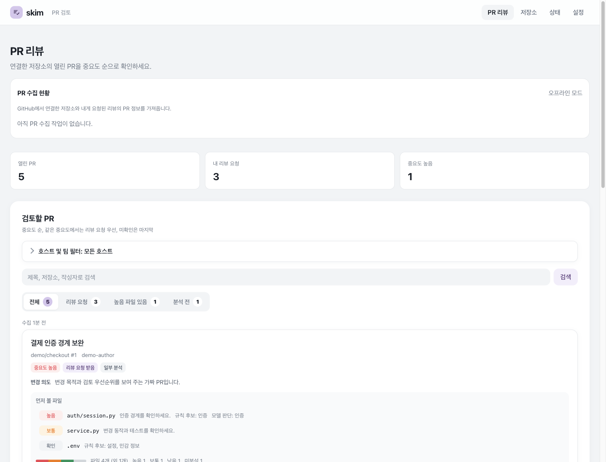
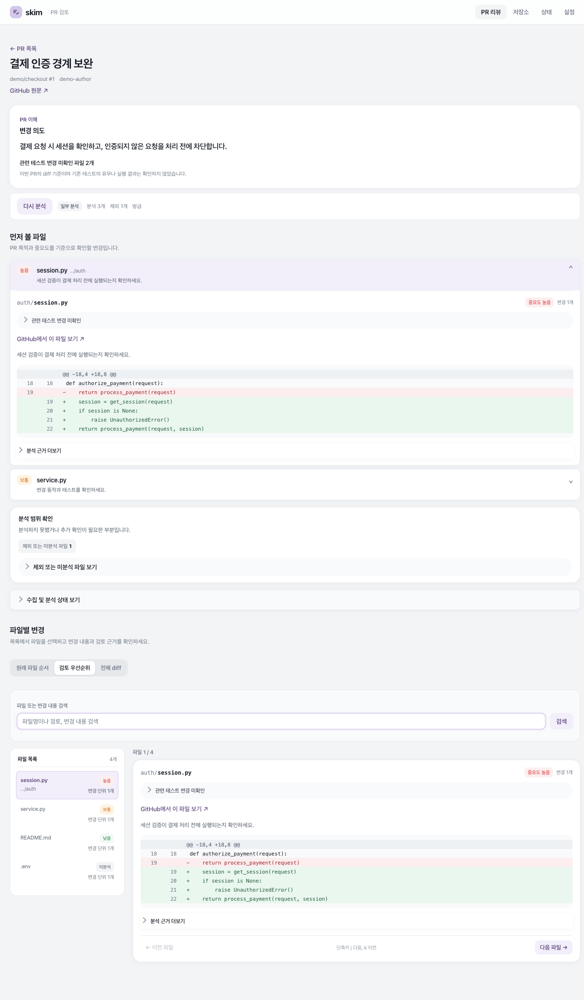
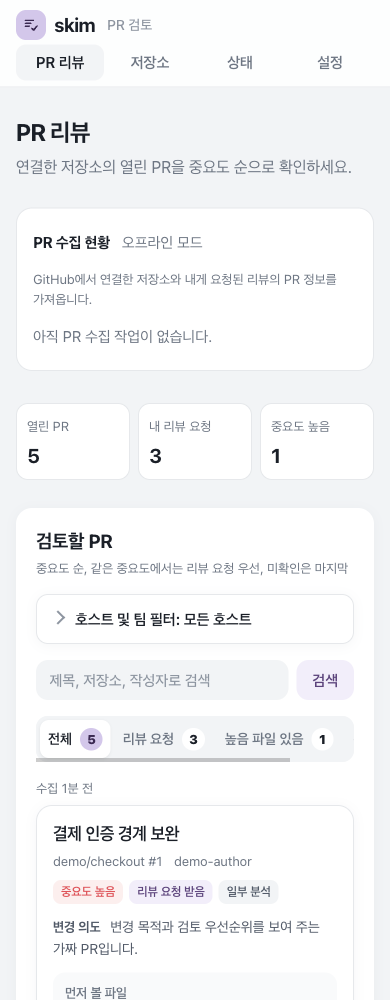
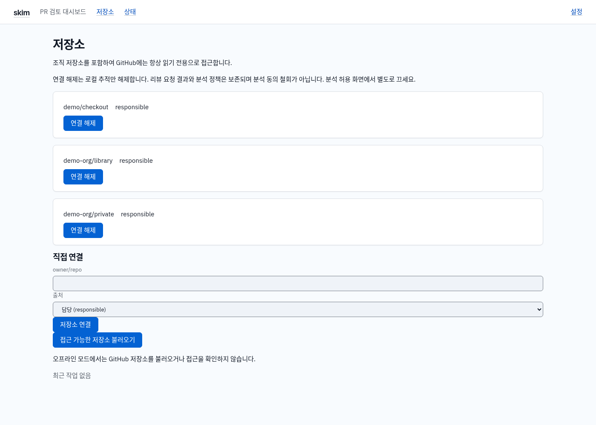
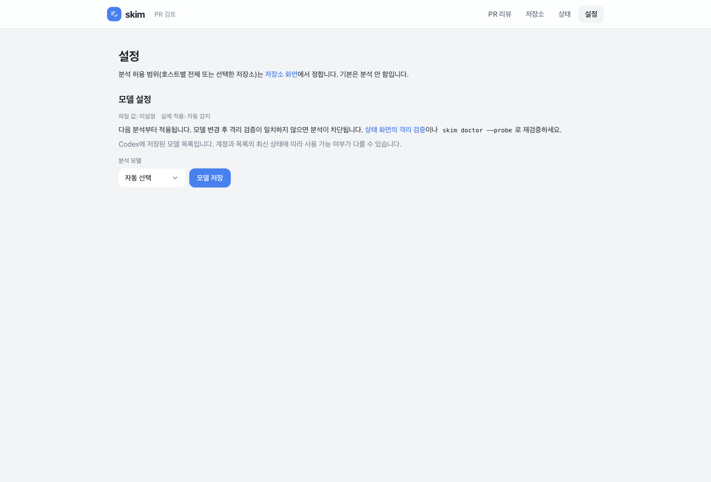
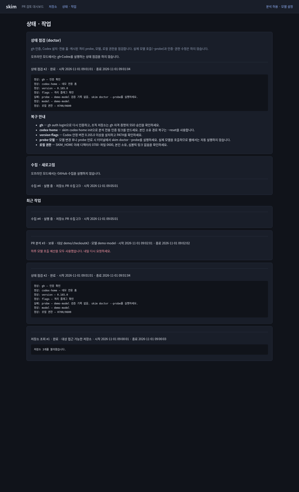

# skim

GitHub PR을 모아 변경 목적과 중요도를 보여주는 로컬 검토 도우미입니다.
터미널에서 **`skim`만 실행하면 로컬 서버가 시작되고 브라우저가 열립니다.**
웹에서 저장소 연결, 분석 허용, 수집·새로고침, PR 분석, 상태 점검과 모델 설정을 진행하세요.







## 설치와 시작

Python 3.11 이상, Git, GitHub CLI(`gh`)가 필요합니다. 별도 Python 패키지는 필요하지 않습니다.
분석에는 로그인된 Codex CLI 안정 버전 0.165.0 이상과 필수 격리 플래그 지원이 필요합니다.

Mac 터미널에서 실행합니다.

```bash
git clone https://github.com/nowgnas/skim.git
cd skim
./setup.sh
export PATH="$HOME/.local/bin:$PATH"
gh auth login
skim
```

설치 스크립트는 `~/.local/bin/skim`에서 저장소의 `bin/skim`으로 심볼릭 링크를 만듭니다.
저장소 폴더를 유지하세요. PATH를 계속 적용하려면 위 `export` 줄을 `~/.zshrc`에 추가하세요.
GitHub.com 로그인과 대상 저장소 읽기 권한이 필요하며, 조직은 SSO 승인과 팀 접근 권한도 확인하세요.

브라우저가 열리지 않으면 터미널에 출력된 URL로 접속하세요. 이미 실행 중이면 기존 서버에서 새 진입 URL을 발급합니다.
서버를 종료하려면 실행한 터미널에서 Ctrl-C를 누르세요.

## 웹에서 사용하기

### 1. 저장소 연결

상단 **저장소**에서 **접근 가능한 저장소 불러오기**를 누르세요.
현재 `gh` 계정이 접근할 수 있는 개인·조직 저장소 목록에서 선택하거나, `owner/repo`를 직접 입력해 연결할 수 있습니다.
목록 조회와 직접 입력의 읽기 접근 확인은 백그라운드 작업으로 실행됩니다.
등록만으로 LLM 분석을 허용하지 않습니다.

연결 해제는 로컬 추적을 해제합니다. 리뷰 요청으로 남은 PR과 분석 정책은 보존되므로,
코드 전송 동의를 철회하려면 설정에서 분석 허용도 별도로 끄세요.



### 2. 분석 허용과 모델 설정

**분석 허용 · 모델 설정**에서 저장소별 또는 조직별 LLM 분석을 명시적으로 허용하세요. 기본값은 꺼짐입니다.
저장소의 명시적 허용·거부가 조직 정책보다 우선하며, 조직 설정 상속도 선택할 수 있습니다.
조직 허용은 리뷰 요청으로 발견된 저장소를 포함해 해당 조직 저장소 전체에 적용됩니다.

**허용하면 PR 코드·diff와 제목·설명이 Codex CLI를 통해 모델 서비스로 전송됩니다.
민감 정보 제외는 완전하지 않으며 서비스의 전송·보존 정책이 적용됩니다.**
저장소 연결, 수집, 분석 버튼 클릭만으로 동의가 켜지지 않습니다.

같은 화면 아래 **모델 설정**의 `codex_model` 입력에 계정에서 사용할 수 있는 모델명을 저장하세요.
파일 값과 실제 적용값을 함께 표시합니다. `SKIM_CODEX_MODEL` 환경 변수가 파일 설정보다 우선합니다.
모델을 바꾸면 다음 작업부터 적용되며 실행 중인 작업은 기존 모델을 사용합니다.



실제 분석을 처음 준비할 때는 터미널에서 다음을 실행하세요.

```bash
codex login
skim codex-home init
skim doctor --probe
```

`--probe`는 저장소 코드 없이 **실제 모델을 호출**하는 격리 검사입니다. 성공 기록은 7일간 유효하며,
모델 변경 후에는 다시 검사해야 합니다. 웹은 probe를 자동 실행하지 않습니다.
환경 변수로 모델을 지정했다면 서버 실행과 probe에 같은 값을 사용하세요.

### 3. 수집·새로고침과 PR 분석

대시보드 또는 **상태 · 작업**의 **지금 수집**을 누르면 열린 PR과 개인·팀 리뷰 요청을 수집합니다.
온라인 서버는 5분 주기로도 수집합니다. 수집 후 자동 분석은 허용된 저장소에만 적용되며,
수동 분석과 동일하게 예산·격리 검사를 따릅니다.

PR을 열어 diff, 변경 목적, 파일·변경 단위별 중요도와 미분석 부분을 확인하세요.
**이 PR 분석**은 해당 PR의 최신 수집 스냅샷을 분석합니다. 최신 SHA가 없으면 먼저 수집하세요.
수동 draft 분석도 동의·예산 검사를 따르며, 하루 20회 모델 호출 예산을 우회하지 않습니다.
다른 분석이 대기·실행 중이면 완료 후 다시 요청하라는 안내를 확인하세요.

본인이 작성한 PR은 조건이 맞으면 로컬 세션 조회 앱인 Sessio의 세션으로 연결됩니다.

### 4. 상태와 작업 진행 확인

**상태 · 작업**에서 **상태 점검 실행**을 누르면 `gh` 인증, Codex 설치·전용 홈,
격리 probe 기록, 모델과 로컬 권한을 점검합니다. 일반 doctor는 실제 모델을 호출하거나 인증·권한을 수정하지 않습니다.

수집, 분석, 저장소 조회, doctor는 공통 백그라운드 큐에서 실행됩니다.
화면에서 대기·실행·완료·실패·보류 상태와 단계·진행 건수(알 수 있을 때)를 확인할 수 있습니다.
진행 중에는 2초 간격으로 상태를 갱신하며, 기존 분석 결과도 계속 볼 수 있습니다.
최근 작업 목록과 실패 시 복구 안내를 확인하세요.



## 데모로 보기

저장소 폴더에서 실행하세요. GitHub·Codex 로그인 없이 가짜 PR 5개를 볼 수 있습니다.

```bash
python3 scripts/demo_seed.py --home /tmp/skim-demo
SKIM_HOME=/tmp/skim-demo skim web --offline
```

GitHub·모델 서비스에 접속하지 않습니다. 이 README의 스크린샷도 데모 데이터입니다.
이미 생성한 데모는 웹만 실행하세요. 새 데모에는 비어 있는 별도 홈을 지정하세요.
오프라인에서는 수집·분석·상태 점검·저장소 조회를 실행하지 않습니다.

## CLI 하위 명령

일상 작업은 웹에서 진행할 수 있으며, 터미널에서는 다음 명령도 사용할 수 있습니다.
`owner/repo`와 `owner`는 실제 저장소·조직 이름으로 바꾸세요.

| 명령 | 용도 |
| --- | --- |
| `skim` | 로컬 서버 시작과 브라우저 열기 (`skim web`과 동일) |
| `skim web --no-browser` | 브라우저 자동 열기 없이 실행 (`--port`, `--offline` 지원) |
| `skim repo add owner/repo` / `skim repo list` / `skim repo remove owner/repo` | 추적 저장소 관리 |
| `skim analysis allow owner/repo` / `skim analysis deny owner/repo` | 저장소 분석 전송 허용·거부 |
| `skim analysis allow --org owner` / `skim analysis deny --org owner` | 조직 분석 전송 허용·거부 |
| `skim analysis reset owner/repo` | 저장소 정책을 지우고 조직 설정 상속 |
| `skim collect` | PR 수집 |
| `skim analyze` | 허용된 최신 스냅샷 분석 (기본 draft 제외, `--include-drafts` 지원) |
| `skim doctor` | 모델 호출 없이 상태 점검 |
| `skim codex-home init` | 분석 전용 인증 링크 초기화 |
| `skim doctor --probe` | 코드 없이 실제 모델 격리 검사 |
| `skim --help` | 전체 명령 도움말 |

## 보안과 데이터

- GitHub API는 읽기 전용입니다. 리뷰 작성·수정·승인·머지를 하지 않습니다.
- 분석을 허용하지 않은 저장소 코드는 모델 서비스로 보내지 않습니다. 실행 직전에도 정책을 재확인합니다.
  수집한 원문 diff는 로컬에 저장하며, 허용된 분석 입력은 Codex 모델 서비스로 전송합니다.
- 웹은 **`127.0.0.1`**에만 바인딩합니다. 접속 URL의 일회용 진입 토큰은 60초 동안 한 번만 사용할 수 있으므로 공유하지 마세요.
  진입 후 `HttpOnly; SameSite=Strict` 세션 쿠키를 사용하며 서버 재시작 시 세션이 사라집니다.
- 모든 변경은 **POST만** 허용합니다. 세션별 CSRF 토큰과 정확한 `Origin`·`Host` 검사로 변경 요청을 보호합니다.
  세션 수립 POST는 일회용 진입 토큰과 `Origin`·`Host` 검사로 보호합니다. GET 조회는 작업을 시작하지 않습니다.
- 설정은 `~/.config/skim/config.json`, DB는 `~/.local/share/skim/skim.db`, diff는 같은 데이터 디렉터리의 `cache/`에 저장합니다.
  `SKIM_HOME`을 지정하면 `$SKIM_HOME/config/`와 `$SKIM_HOME/data/`를 사용합니다.
  전용 디렉터리는 0700, 설정·DB 파일은 0600입니다.
- 중요도는 검토 순서의 참고 자료입니다. 현재 실제 모델 회귀 평가가 없어 출시가 차단된 상태입니다.
  [출시 체크리스트](docs/release-checklist.md)를 확인하세요.

## 문제 해결

| 증상 | 조치 |
| --- | --- |
| `skim: command not found` | 설치 절의 PATH 설정을 적용하거나 저장소에서 `bin/skim`을 실행하세요. |
| Python 버전 오류 | 래퍼는 `python3`, `python3.20`…`python3.11` 순으로 3.11 이상을 찾습니다. 설치하거나 `SKIM_PYTHON`으로 실행 파일을 지정하세요. 사용 중인 인터프리터는 `skim doctor`의 `python` 줄에 나옵니다. |
| 저장소 조회·수집 실패 | `gh auth login`과 웹 상태 점검으로 확인하세요. 조직 SSO·비공개 저장소·팀 접근 권한도 필요합니다. |
| 분석이 차단됨 | 분석 허용, 최신 수집 스냅샷, 웹 상태 점검을 확인하세요. probe 만료·실패·모델 변경 시 `skim doctor --probe`를 실행하세요. |
| Codex 홈 검사 실패 | `codex login`과 초기화 때의 `CODEX_HOME`을 확인하세요. 전용 홈의 다른 파일은 `skim codex-home init --reset` 후 probe로 복구하세요. |
| 원본 Codex CLI 로그인 실패 | 인증 refresh token 교체로 무효화될 수 있습니다. 원본 CLI에서 `codex login`을 다시 실행하세요. |
| 진입 토큰 만료·사용됨 | `skim`을 다시 실행해 새 URL을 받으세요. |
| 모델 설정과 실제 적용값이 다름 | 서버 터미널의 `SKIM_CODEX_MODEL`을 확인하고 probe에도 같은 모델을 사용하세요. |

정책 상속·분석 예산·캐시·격리·Sessio 연결은 [상세 문서](docs/02-details.md),
웹 인증과 화면 동작은 [웹 문서](docs/04-web.md),
웹 우선 전환의 구현 상태는 [웹 우선 설계 부록](docs/05-web-first.md),
전체 설계는 [설계 문서](docs/01-design.md)를 참고하세요.

### 회사 GitHub 연결

터미널에서 `gh auth login --hostname github.corp.example`로 로그인한 뒤,
웹의 **저장소(/repos)** 에서 호스트를 추가하고 해당 호스트를 선택해 **저장소 불러오기**를 누르세요.
회사 GitHub도 항상 읽기 전용으로 접근하며, LLM 분석은 기본 OFF입니다.
필요한 경우 설정에서 해당 호스트의 저장소 또는 조직별로 분석을 허용하세요.
